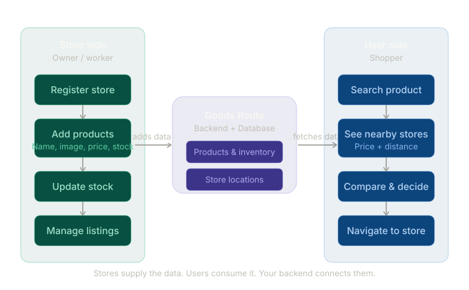

# GoodsRoute

"Google Maps for products": search for an item and find the nearby stores that stock it, compared by price and distance. This repository is the backend.

> **Status: in development.** What's here today is the API below: stores, listings and PostGIS radius search. Photo search, JWT authentication and the consumer app are next on the roadmap.



## API

| Method | Path | What it does |
|---|---|---|
| GET | `/health` | Health check |
| GET, POST | `/stores/` | List or create stores (each with a geographic location) |
| GET | `/stores/{store_id}` | One store |
| GET, POST | `/listings/` | List or create product listings |
| GET, PATCH, DELETE | `/listings/{listing_id}` | Read, update or remove a listing |
| GET | `/listings/nearby` | Listings from stores within `radius_m` of a point |
| GET | `/listings/nearby/store/{store_id}` | Listings near a given store |
| GET | `/search/` | Nearby search. It casts store locations to `geography` and filters with `ST_DWithin` (default radius 3 km, max 100 km) |

## Stack

FastAPI · SQLAlchemy 2 · GeoAlchemy2 · PostgreSQL + PostGIS · Alembic migrations · Docker Compose

## Prerequisites

- Docker and Docker Compose
- Python 3.11+ (for local development)

## Quick Start

1. Copy `.env.example` to `.env` and configure:
   ```bash
   cp .env.example .env
   ```

2. Start services with Docker Compose:
   ```bash
   docker-compose up -d
   ```

3. Run database migrations:
   ```bash
   alembic upgrade head
   ```

4. Start the development server:
   ```bash
   uvicorn app.main:app --reload --host 0.0.0.0 --port 8000
   ```

5. Access the API:
   - API: http://localhost:8000
   - API Docs: http://localhost:8000/docs
   - Redoc: http://localhost:8000/redoc

## Project Structure

```
.
├── app/
│   ├── __init__.py
│   ├── main.py
│   ├── config.py
│   ├── database.py
│   ├── models/
│   ├── schemas/
│   ├── api/
│   │   ├── __init__.py
│   │   ├── routes/
│   │   └── dependencies.py
│   └── core/
│       ├── security.py
│       └── utils.py
├── alembic/
├── scripts/
├── tests/
├── docker-compose.yml
├── .env.example
├── requirements.txt
└── README.md
```

## Development

### Running Tests

```bash
pytest
```

### Database Migrations

Create a new migration:
```bash
alembic revision --autogenerate -m "description"
```

Apply migrations:
```bash
alembic upgrade head
```

## Environment Variables

See `.env.example` for all available configuration options.

